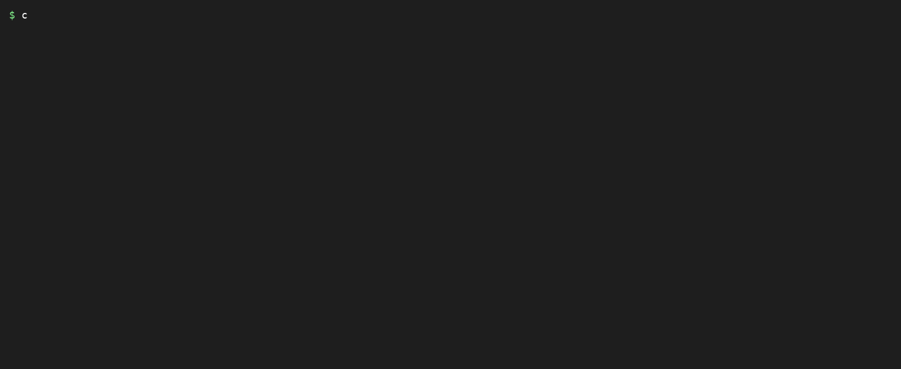

# cargoscope

Measure where your Rust build time actually goes — per crate, per build script, per link step — then get the cheapest fixes ranked first, and verify the delta on your own crate.

Built for Rust developers who are tired of deciding toolchains on headlines. `cargoscope` shells out to `cargo build --timings`, parses the timing data, runs a second no-change rebuild to catch build scripts that re-run on every build, and reports. It never changes your toolchain: recommendations come as config snippets for you to apply.



## Install

```sh
npm install -g cargoscope
# then, inside any Rust crate:
cargo cargoscope measure
```

Requires Node 20+ and a Rust toolchain (stable is fine; a nightly toolchain that still
supports `-Ztime` unlocks link-step timing — the flag was removed from rustc by
1.101-nightly, and cargoscope probes support first instead of assuming it).

## 30-second tour

```sh
$ cargo cargoscope measure --json before.json

cargoscope measure — profile dev (stable)
  wall time:        14.2s
  units compiled:   38 (12 did real work)

where the time goes (top crates):
  serde 1.0.228 [lib]                         6.4s   45% █████████░░░░░░░░░░░
  myapp 0.3.0 [lib]                           3.1s   22% ████░░░░░░░░░░░░░░░░
  ...

build scripts:
  myapp: compile 0.2s, run 0.4s  <-- RE-RUNS ON EVERY BUILD

$ cargo cargoscope recommend
1. [free] Use `cargo check` for the edit/compile loop
   ...
2. [free] Fix 1 build script(s) that re-run on every build
   ...

# ...you apply a fix, then:
$ cargo cargoscope measure --json after.json
$ cargo cargoscope compare before.json after.json

before/after
  wall:   14.2s -> 10.9s  (-23.2%)
verdict: -23.2% wall time faster (14.2s -> 10.9s)
```

## Commands

- `cargo cargoscope measure [--profile dev|release] [--json out.json]` — timed build + no-change rebuild; reports top crates, build-script re-runs, codegen+link share. Exit 0.
- `cargo cargoscope recommend [--from manifest.json] [--nightly-ok]` — ranked fixes, cheapest first, with exact config snippets. Changes nothing.
- `cargo cargoscope compare <before.json> <after.json>` — before/after delta. Only measured numbers; nothing is promised.
- `cargo cargoscope --version`

## What it is NOT (honest limits)

- It does not speed up your builds. It measures. If you want the build itself to go faster without measuring first, this is the wrong tool.
- It does not apply toolchain changes. Switching linkers or codegen backends carries real risk; the snippets are yours to review and apply.
- Timing numbers are your machine's, your crate's, your profile's. A -23% here is not a claim about any other setup.
- Link-step timing needs a nightly toolchain whose rustc still accepts `-Ztime`
  (removed from rustc by 1.101-nightly; support is probed, never assumed).
  Otherwise the binary unit's duration covers codegen+link together and the
  report says so.
- `cargo --timings` output format is not a stable API. The parser is defensive and records the tested cargo version; if cargo changes the format, `measure` fails loudly instead of guessing.

## How re-run detection works

`measure` runs cargo twice: once timed, once as a no-change rebuild. Cargo omits fresh-skipped units from the timing report, so a build-script-run unit that appears with real duration in the second build was genuinely executed again with no source changes — its freshness is broken (typically a script that rewrites its own `rerun-if-changed` inputs). This is measured, not inferred from the script source.

The two builds run with `CARGOSCOPE_BUILD_SEQ=1` and `CARGOSCOPE_BUILD_SEQ=2` in the environment, so a build script can declare `cargo:rerun-if-env-changed=CARGOSCOPE_BUILD_SEQ` to deterministically exercise the re-run path (the bundled fixture crate does this). Harmless for real crates: scripts that don't declare the variable are unaffected.

## Where the alternatives win

- **[cargo-blaze](https://github.com/indexable-inc/blaze)** wins if in-place recompilation fits your workflow — it actually makes rebuilds faster instead of measuring them. It is a young, invasive bet (replaces the compiler driver); cargoscope complements it (it can measure blaze's own delta).
- **`cargo build --timings`** wins on zero install — the raw HTML timeline has everything cargoscope parses. cargoscope adds ranking, re-run detection, and before/after verification on top.
- **`cargo-bloat`** answers a different question (binary size, not build time).

(Checked 2026-11-02.)

## Risk register

| Risk | Level | Handling |
|---|---|---|
| cargo changes the `--timings` HTML schema | Medium | Defensive parser + loud failure; tested cargo version recorded in the build note |
| Single-machine numbers mistaken for general claims | Medium | README states machine/crate/profile scope; `compare` prints measured deltas only |
| Recommending nightly-only tooling to stable users | Low | Nightly items gated behind `--nightly-ok`, labeled in output |
| Two cargo builds per `measure` is slow on huge workspaces | Low | Documented; `--from` lets `recommend` reuse a manifest |

## Contributing

Issues and PRs welcome. Please include the output of `cargo cargoscope measure` (redacted paths are fine) when reporting wrong numbers.

## License

MIT — see [LICENSE](LICENSE).
